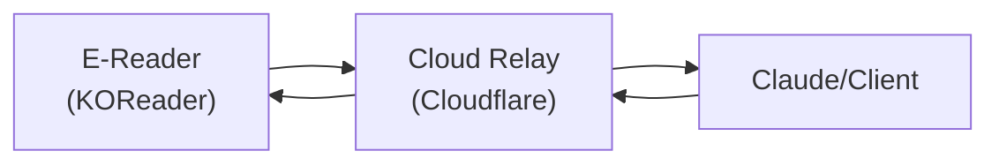

# MCP Server Plugin for KOReader

A KOReader plugin that implements a [Model Context Protocol (MCP)](https://modelcontextprotocol.io) server, enabling AI assistants to interact with your e-books in real-time.

<details><summary>What is MCP?</summary>

The Model Context Protocol (MCP) is an open standard that enables AI assistants to securely connect to external data sources and tools. This plugin implements an MCP server that exposes your KOReader book content and functionality to compatible AI assistants.

</details>

## Features

- **Book Content Access**: AI assistants can read your current book's content at different scopes (current page, chapter, specific page ranges)
- **Metadata Retrieval**: Access book metadata including title, author, reading progress, and statistics
- **Interactive Tools**: Search within books, navigate to pages, get table of contents, add highlights and notes
- **Any modern MCP client**: Speaks both stateless MCP (2026-07-28) and the earlier handshake-based versions (2025-03-26 to 2025-11-25) on the same endpoint
- **Asks you when it matters**: With clients that support elicitation (e.g. Claude), the server asks you before overwriting a note you already wrote
- **Local Network Protection**: Requests from web pages on other sites are rejected (Origin validation against DNS rebinding)
- **Cloud Relay**: Access your e-reader from anywhere via a cloud relay

### Why not just use the [KOAssistant plugin](https://github.com/zeeyado/koassistant.koplugin)?

It's a great plugin and I recommend trying it out! I personally use _both_. 

- KOAssistant uses an API and requires setting up access keys (not a problem, but a bit more technical setup)
- It's very convenient for quick interaction _on-device_: e.g. translating or explaining selected text
- It's not great for longer interactions that require _typing_ which is usually a _pain on e-readers_
- While KOAssistant chats can be saved, they will not appear in your main AI assistant app's chat history (which _may_ be desired because of the memories that your AI assistant builds over time)

### Where does KOReader MCP shine?

- You are reading a book and want to have a full conversation about it with your AI assistant (e.g., Claude, ChatGPT, DeepSeek or even local LLMs)
- It can be especially useful when studying or reading on complex topics (research, philosophy, technical books), where you want to discuss ideas and brainstorm
- You can open a chat on your phone or computer, and talk to the AI about your current reading context without finicky interactions on the slow e-reader screen
- The chat _history_ and _memories_ are stored in your AI assistant app, keeping everything in one place and allowing for richer interactions over time (e.g. making connections between conversations or even different books)
  - Note: this is optional and is totally up to you how you want to use it

## Installation

> [!IMPORTANT]
> This is an early implementation. Use it at your own risk. I make **NO GUARANTEES** about stability, security, or data integrity. You're welcome to review the code and suggest improvements.

### Via an app store plugin (recommended)

Use the [App Store plugin](https://github.com/omer-faruq/appstore.koplugin) (or any other similar one) to install the MCP server plugin directly from KOReader. Simply search for "MCP" and install the plugin via the UI. This method ensures you get updates automatically.

### Manually

1. Download or clone this repository
2. Copy the `mcp.koplugin` directory to your KOReader plugins folder
3. Restart KOReader

To update, repeat the steps above with the latest version.

### Over Wi-Fi (for testing a branch)

Turn on KOReader's SSH server (**⚙️ Settings → Network → SSH server**, port 2222) and add your public key to `koreader/settings/SSH/authorized_keys`. Then, from a checkout of the branch you want:

```sh
scripts/push-to-device.sh <reader-ip>
```

It finds KOReader's folder on Kobo, Kindle, Android and PocketBook, or takes the folder as a second argument. Restart KOReader afterwards (**Menu → Exit → Restart KOReader**).

## Usage

### Starting the Server

1. Tap the menu (top of screen) and open 🛠️ **Tools**
2. You will see a checkbox for **MCP server**
   - Tap it to start or stop the server
   - Long-press to switch between local/remote modes or to see the details

#### Settings

1. Tap the menu and navigate to **⚙️ Settings → Network → MCP server**
2. Configure server settings:
   - **Start server automatically**: Enable to start the server when KOReader launches (requires WiFi)
   - **Idle timeout**: Set inactivity period before auto-stopping the server.  
      <sub>When the idle timeout is enabled, you'll see a warning notification 5 seconds before the server stops. Tap the notification to reset the idle timer and keep the server alive.</sub>

   - **Turn off WiFi on idle timeout**: Save battery by disabling WiFi when server stops due to idle timeout
   - **Offline memory** (remote mode, off by default): Let connected AI apps keep answering from a saved copy while the reader is asleep or away. See [Offline memory](#offline-memory)
3. Switch between local and cloud relay modes:
    - **Local mode**: Server listens on local network only
    - **Cloud relay**: Enable to use the cloud relay for remote access


> [!TIP]
> Hold any menu item to open the help tooltip

### Connecting an AI Assistant

Check the **MCP server status** in the Tools menu for the MCP server address. Use this address to configure your AI assistant or MCP client (e.g., Claude or Gemini).

#### Claude

1. Go to **Settings → Connectors → Add custom connector**, or just us this link: https://claude.ai/settings/connectors?modal=add-custom-connector.
2. Enter the name (e.g., "KOReader") and the MCP server URL.
3. When Claude opens the relay's sign-in page, open **MCP server → Connect an AI app** on the reader and enter the 6-digit code it shows.
4. Open a new chat and in the ➕ menu you should see the new connector available. You can either add resources to the context, or ask it to use tools to fetch data from your book.

#### Gemini

1. Go to **Settings → Developer mode → Create new** (app).
2. Paste the MCP server URL (with the cloud relay, it is `https://mcp-relay.laughedelic.workers.dev/mcp`) and follow the pairing step: open **MCP server → Connect an AI app** on the reader and enter the 6-digit code on the relay's sign-in page.
3. Start a chat and ask about the book you're reading.

> [!NOTE]
> KOReader has to be running with a book open and the MCP server on while you chat.

### Chatting About Your Book

Once connected, you can ask your AI assistant questions like:

- "What is this book about?"
- "Summarize the current chapter"
- "What does the quote on this page mean?"
- "Search for other mentions of [character/topic] on this page and explain their significance"
- "Add a note with a translation of this selected text"
- "Highlight this important passage"

Assistant will use the MCP resources and tools to understand which book you're reading, what's on your screen, search within the book, and provide relevant responses. You can also ask the assistant to add highlights and notes to your book based on your conversation.

> [!TIP]
> It might be helpful to create a separate project with more focused instructions for using KOReader MCP or even for a particular book that you want to discuss with your AI assistant. This will keep the context relevant and maintain separate memory for different books or topics.

## MCP server capabilities

> [!WARNING]
> This is an early implementation and this list may change and be not up-to-date.

### Resources

The plugin exposes these resources:

#### Current Book Resources
| Resource URI                    | Description                                        |
| ------------------------------- | -------------------------------------------------- |
| `book://current/context`        | Current reading context (page, chapter, selection) |
| `book://current/metadata`       | Book metadata (title, author, progress, etc.)      |
| `book://current/toc`            | Table of contents                                  |
| `book://current/bookmarks`      | Bookmarks and highlights in the current book       |
| `book://current/pages/{range}`  | Text from specific pages (e.g., `5` or `10-15`)    |
| `book://current/chapters/{idx}` | Text from a specific chapter by index              |

#### Library Resources
| Resource URI             | Description                          |
| ------------------------ | ------------------------------------ |
| `library://books`        | List of all books in the library     |
| `library://collections`  | Book collections/shelves             |
| `library://history`      | Reading history                      |
| `library://books/{path}` | Metadata for a specific book by path |

### Tools

The plugin provides these callable tools:

| Tool                  | Description                                                                  | Parameters                                                                 |
| --------------------- | ---------------------------------------------------------------------------- | -------------------------------------------------------------------------- |
| `get_reading_context` | Get current reading context (book, chapter, page, selection/highlight focus) | `extra_pages_before` (optional), `extra_pages_after` (optional)            |
| `get_book_metadata`   | Get full book metadata (for clients without resource support)                | None                                                                       |
| `read_pages`          | Read text from specific pages or chapters                                    | `pages` (e.g., "5" or "10-15"), `chapter` (index)                          |
| `search_book`         | Search for text in the book                                                  | `query`, `case_sensitive` (optional)                                       |
| `goto_page`           | Navigate to a specific page                                                  | `page`                                                                     |
| `annotate`            | Add highlight or note to text (EPUB, FB2, PDF, DjVu...)                      | `note`, `note_format`, `text`, `start`, `end`, `if_note_exists` (all optional) |

#### Tool Annotations

All tools include [MCP annotations](https://modelcontextprotocol.io/docs/concepts/tools#tool-annotations) to help AI assistants understand their behavior:

- `readOnlyHint`: Tools like `get_reading_context`, `get_book_metadata`, `read_pages`, `search_book` are read-only
- `destructiveHint`: The `annotate` tool is marked destructive, because with `if_note_exists = "replace"` it can overwrite an existing note
- `idempotentHint`: Multiple calls with the same parameters produce the same result
- `openWorldHint`: Whether the tool interacts with external entities

### Prompts

Prompts are pre-defined conversation starters for common reading companion interactions. MCP clients that support prompts (like Claude) can present these as quick actions.

| Prompt      | Title           | Description                                                   |
| ----------- | --------------- | ------------------------------------------------------------- |
| `explain`   | Explain This    | Explain selected text or current page content                 |
| `summarize` | Summarize       | Summarize page, chapter, or reading progress                  |
| `discuss`   | Let's Discuss   | Start a conversation about themes and ideas                   |
| `research`  | Research This   | Get background info about book, author, or historical context |
| `note`      | Take a Note     | Create and save annotations with assistant help               |
| `quiz`      | Quiz Me         | Test comprehension with generated questions                   |
| `translate` | Translate       | Translate text to another language                            |
| `recommend` | Recommend Books | Get personalized book recommendations                         |

### Protocol Versions

| Client speaks            | How it connects                                                                                        |
| ------------------------ | ------------------------------------------------------------------------------------------------------ |
| 2026-07-28 (stateless)   | Every request carries its version and capabilities in `_meta`; `server/discover` describes the server |
| 2025-03-26 to 2025-11-25 | `initialize` handshake; the server answers with the client's version                                    |

Clients that speak both try 2026-07-28 first and fall back automatically.

### Elicitation

On 2026-07-28 clients that declare form elicitation, `annotate` asks the user before changing a note that already exists (replace it, add below it, or keep it). The question travels inside the tool result (an `input_required` result, the protocol's multi round-trip request pattern) and the client retries the call with the answer, so it works through the cloud relay without any extra channel. With other clients, the tool doesn't touch the note and asks the AI to check with you and call again with `if_note_exists`.

### Not Supported

- **Sampling and server logging**: deprecated in MCP 2026-07-28 and not implemented.
- **Live change notifications** (page turns, book changes): planned through the 2026-07-28 `subscriptions/listen` stream. Until then the server doesn't advertise resource subscriptions, so clients don't wait for updates that never arrive.


## Local & Remote Modes

### Local Mode

In local mode, the MCP server runs on your e-reader and listens for connections on your local network (WiFi). This would be the default mode, but unfortunately some AI clients (most notably Claude Mobile) cannot connect to local network addresses and require a fully remote-accessible server.

The server accepts requests on `/` and `/mcp`. Requests carrying an `Origin` header are accepted only from `localhost` or the e-reader's own address, so a web page you open can't reach your library through your browser. Local mode has no authentication, so use it only on networks you trust.

So for now this mode is kept for testing and limited use with compatible clients. I've tested it with GitHub Copilot with this configuration (replace `LOCAL_IP`):

```json
"koreader": {
  "type": "http",
  "url": "http://LOCAL_IP:8788"
}
```

> [!INFO]
> If you test it with other clients in local mode, please share your experience. Or if you have ideas on how to make local mode more useful, let me know!

### Remote Mode (Cloud Relay)

The cloud relay feature allows you to access your MCP server from anywhere — Claude Desktop, Claude Mobile, or other AI tools — without complex network setup like VPNs or port forwarding.



1. **On first connection**, your e-reader generates a device ID (based on your device type) and a random device secret, and registers with the relay
2. Your e-reader shows the relay URL and a one-time 6-digit **pairing code**
3. You add the URL as a connector in your AI app and enter the code on the relay's sign-in page
4. The AI app exchanges the authorization for a short-lived access token; the code is used up

#### Authentication Flow

When you first start the MCP server in remote mode, you'll see the **relay URL** and a **pairing code**. To connect another app later, use **Connect an AI app** in the MCP settings menu (**Settings → Network → MCP server**). Each code works once, for 10 minutes. Once an app signs in, the reader closes the code and tells you which app connected.

**Connected apps** in the same menu lists the AI apps that can reach your reader. Tap one to disconnect it.

The relay uses OAuth 2.1 Authorization Code flow with PKCE, so MCP clients that support OAuth will handle authentication automatically.

> [!NOTE]
> With an older or self-hosted relay that doesn't support pairing codes, the plugin shows a device ID and a permanent 6-digit passcode instead, which you enter on the sign-in page.

> [!IMPORTANT]
> The relay is just a bridge forwarding requests between your e-reader and AI clients. Unless you turn on [offline memory](#offline-memory), it does not store book content, highlights or notes; it keeps only what it needs to route and authorize requests (see the [privacy policy](PRIVACY.md)).

The relay implementation is open source: [koreader-mcp-cloud-relay](https://github.com/laughedelic/koreader-mcp-cloud-relay). You can deploy your own instance for full control. By default, plugin uses the relay I deployed for myself. I'll be sharing it as long as it's within the free tier limits.

#### Security

- **One-time pairing codes**: A code works once and expires after 10 minutes; only your e-reader can request one (with its device secret), and the relay limits wrong guesses. Once the reader requests its first pairing code, the old permanent passcode stops working for new sign-ins
- **OAuth 2.1 Authorization Code + PKCE**: MCP clients authenticate via the /authorize sign-in page, then exchange a code for a token
- **Revocable**: Disconnect any AI app from **Connected apps** on the reader
- **Short-lived tokens**: Access tokens expire in 1 hour
- **Audience validation**: Tokens are bound to your specific device
- All traffic is encrypted (HTTPS), and the plugin verifies the relay's certificate and host name before sending its credentials. If your e-reader's clock is far off, the check fails; fix the date and time. For a development relay with a self-signed certificate, set `mcp_relay_tls_verify = false` in KOReader's `settings.reader.lua`
- The relay doesn't store any book content, only forwards authenticated requests. The one exception is the encrypted copy you can opt into with [offline memory](#offline-memory)
- **Device secret** (needs an up-to-date relay): Your e-reader also generates a random secret that authenticates its connection to the relay, so knowing your device ID is not enough to receive your requests. The relay never forwards your AI client's access token to the e-reader. An older self-hosted relay ignores the secret, lets anyone who knows the device ID poll, and forwards the client's `Authorization` header, so the plugin shows a warning when the relay doesn't confirm the secret
- You can reset your device ID anytime from the settings menu

#### When the reader is offline

E-readers sleep, turn WiFi off and stop the MCP server to save battery, so the reader is often away when you ask your AI app something. The relay then answers for it: the app keeps its tools and is told that the reader is offline and when it was last connected, instead of getting an error. Nothing from your books is involved in that answer.

#### Offline memory

Offline memory is optional and off by default. Turn it on in **Settings → Network → MCP server → Offline memory**, and your reader keeps a copy of what you are reading on the relay, so connected AI apps can still discuss it while the reader is asleep or away.

- **Save my place, highlights and notes**: the book's title and author, where you are, the table of contents, and your highlights and notes
- **Also save the pages around my place**: additionally the text of the page you are on, 2 pages before it and 10 after
- **Off**: nothing is saved, and a copy saved earlier is deleted

While you read with WiFi on, the reader updates the copy about once a minute, also while the MCP server is off. It also saves when you close the book and when the MCP server stops, for example because the reader goes to sleep. It never turns WiFi on by itself. If you read with WiFi off, the copy is updated the next time WiFi is on.

When the reader is offline, the AI app gets answers from the copy for reading context, book metadata, the saved pages and search within them. Every such answer says that it comes from a saved copy, when it was saved and which pages it covers. Turning pages and adding highlights or notes need the reader itself. As soon as the reader is back online, answers come from the reader again.

The relay stores the copy encrypted, so that opening it takes one of your connected AI apps, and deletes it 30 days after its last update (you can choose 1 or 7 days). An app you connect later can read the copy from the next save on. The [privacy policy](PRIVACY.md) has the details.

> [!NOTE]
> Offline memory needs a relay that supports it. The menu entry only shows up when the relay offers it.

#### Privacy

See [PRIVACY.md](PRIVACY.md) for what the public relay stores and how to delete it.

## References

- Built for [KOReader](https://github.com/koreader/koreader)
- Implements [Model Context Protocol](https://modelcontextprotocol.io) by Anthropic
- Inspired by [koassistant.koplugin](https://github.com/zeeyado/koassistant.koplugin)
